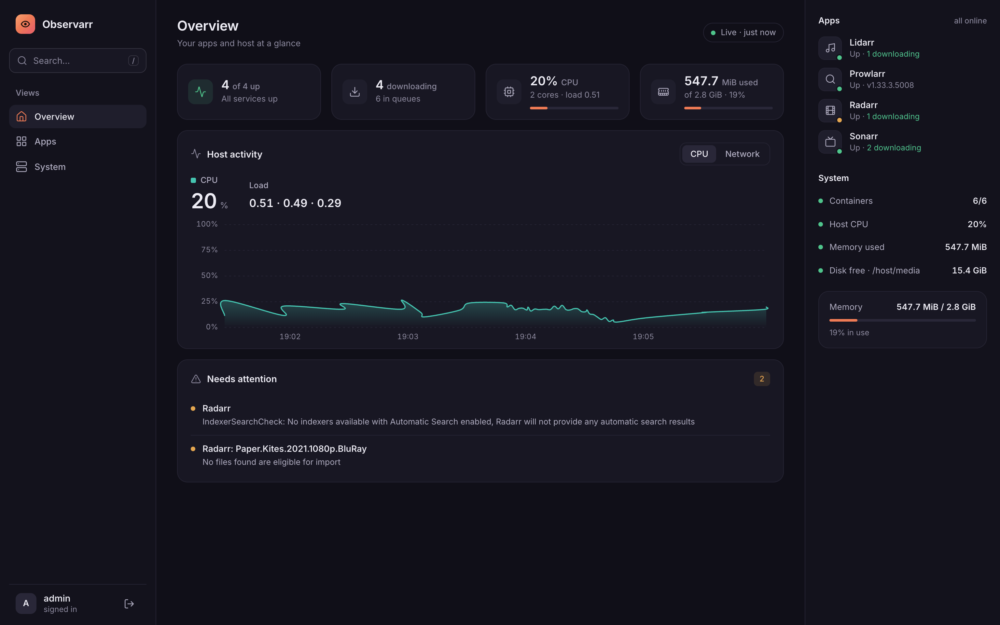
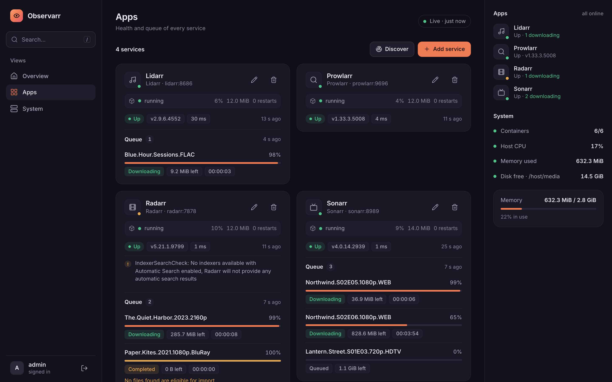
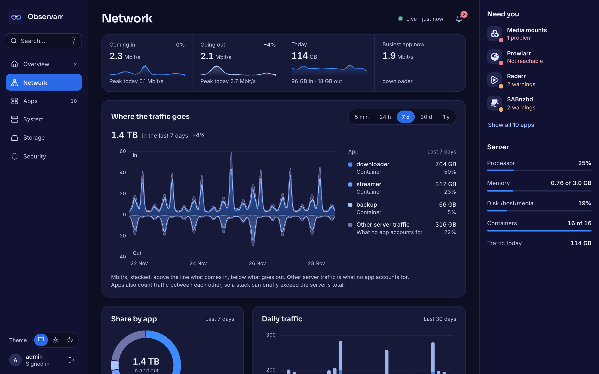
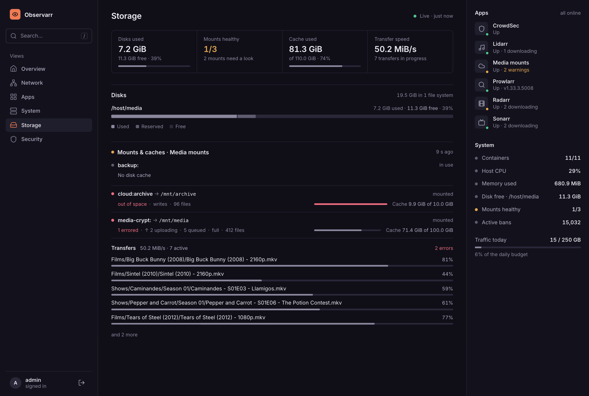
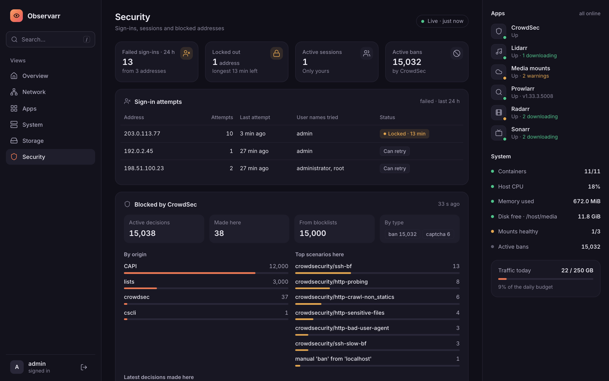
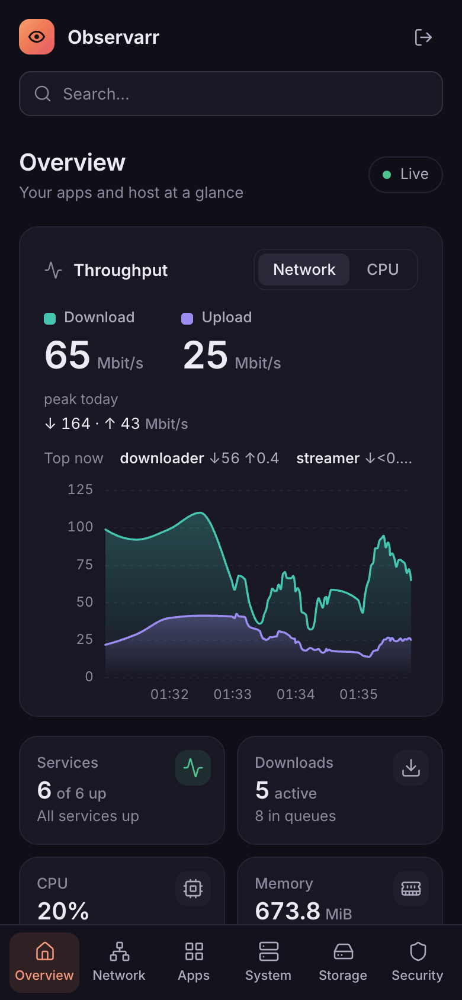
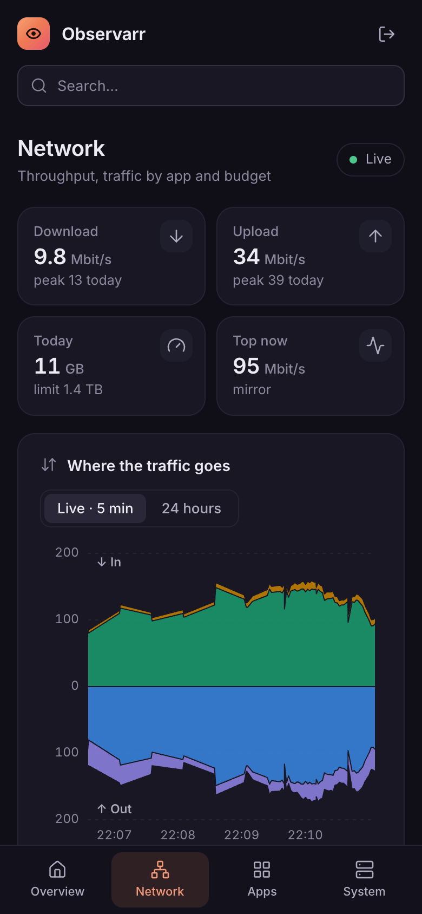
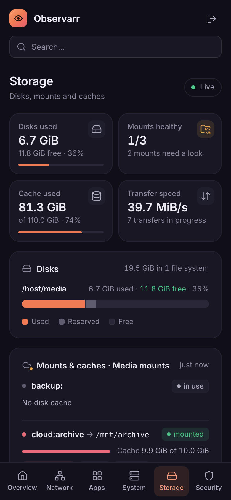

<div align="center">

# Observarr

**A self-hosted ops cockpit for your \*arr and media stack.**

[](https://github.com/whenphdtho/observarr/actions/workflows/ci.yml)


<sub>▶ [Watch in full quality (MP4)](docs/images/demo.mp4)</sub>

</div>

Observarr shows what your \*arr apps, your host and its containers are doing, live, from one small container.
It finds your apps but contacts none of them until you click. Status: early development.

- **Overview:** what needs attention first, then live throughput, services, downloads, CPU and memory.
- **Apps:** health, warnings and download queues for Sonarr, Radarr, Lidarr and Prowlarr.
- **Requests:** what Overseerr or Jellyseerr users asked for, and what waits for approval.
- **Network:** where your traffic goes, by app, live and over 24 hours, with an optional daily or monthly budget.
- **Storage:** disks, plus rclone mounts, VFS caches, uploads and transfers.
- **Security:** failed sign-ins, lockouts, sessions and CrowdSec bans.
- **System:** host CPU, memory, disks and network, and every container's state and resources.

Read-only by design: host mounts are read-only and Docker is reached through a proxy that only answers GET requests.
One Go binary with the UI embedded and SQLite, running non-root on a distroless image; saved API keys are
encrypted at rest. Works on a phone, too.

<table>
  <tr>
    <td width="50%"></td>
    <td width="50%"></td>
  </tr>
  <tr>
    <td></td>
    <td></td>
  </tr>
  <tr>
    <td></td>
    <td></td>
  </tr>
</table>

<p align="center">
  
  &nbsp;
  
  &nbsp;
  
</p>

More screenshots: [Add apps](docs/images/add-apps.png) · [first start](docs/images/add-apps-found.png) ·
[a card expanded](docs/images/apps-expanded.png) · [Network over 24 hours](docs/images/network-24h.png)

## Quick start

```sh
docker build -t observarr .
mkdir -p data && sudo chown 65532 data
docker run -d --name observarr -p 9898:9898 -v "$PWD/data:/data" -e OBSERVARR_INSECURE_COOKIES=1 observarr
docker logs observarr   # shows: setup token: <token> (also in data/setup-token)
```

Open `http://<host>:9898` and create the admin account with the setup token from the log. The token proves you
have access to the host, and it is deleted once setup succeeds.

> [!NOTE]
> Logging in needs HTTPS. Behind a reverse proxy, set `OBSERVARR_TRUSTED_PROXIES` to the proxy's address and
> drop `OBSERVARR_INSECURE_COOKIES`; use that variable only on a plain-HTTP LAN with no proxy. See
> [Reverse proxy](docs/configuration.md#reverse-proxy).

For the host and container figures and for listing your app containers, use
[`deploy/docker-compose.yml`](deploy/docker-compose.yml) (Observarr plus a read-only Docker socket proxy). No
image is published yet, so it builds from the repo:

```sh
mkdir -p deploy/data && sudo chown 65532 deploy/data
docker compose -f deploy/docker-compose.yml up -d --build
```

## Adding your apps

Open **Apps → Add apps**. It lists the app containers and config folders Observarr can see, without contacting
any of them. Click **Add**, enter the API key (Settings → General → Security in each app) or tick "Use the API
key found in …", then **Test & add**. You can also scan your network, ask Prowlarr for its linked apps, or add an
app by hand.

Use a URL Observarr can reach: the container name on a shared Docker network (`http://sonarr:8989`) or the
app's LAN address and port. `localhost` is Observarr's own container. Details, Docker labels and config folders:
[docs/configuration.md](docs/configuration.md#adding-your-apps).

## Docs

- [Configuration and operation](docs/configuration.md): every setting, adding apps in detail, data folder, reverse proxy, security and recovery.
- [Deploy](docs/deploy.md): host and container figures, Storage and rclone, CrowdSec, memory and security notes.
- [Adapters](docs/adapters.md): how app support works and how to add an app.

Development: `make ui` builds the web app, `make check` runs gofmt, vet and tests, `make build` builds the binary.

## License

[GPL-3.0](LICENSE). Ships the [Inter](https://github.com/rsms/inter) and [Sora](https://github.com/sora-xor/sora-font)
fonts (OFL) and [Lucide](https://lucide.dev) icons (ISC). App logos belong to their projects and are shown only to identify them; see [NOTICE](NOTICE).
