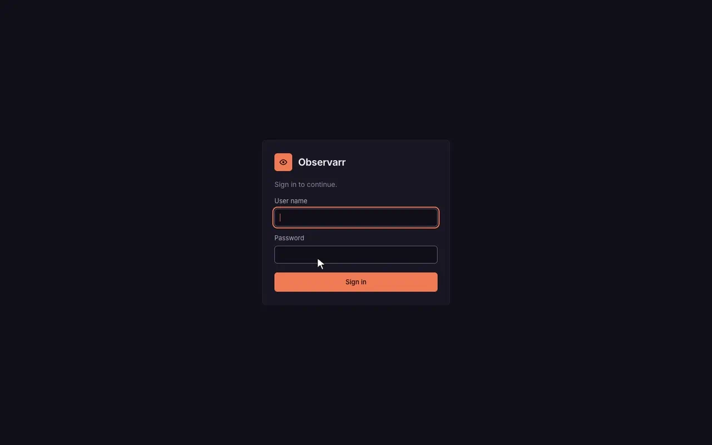
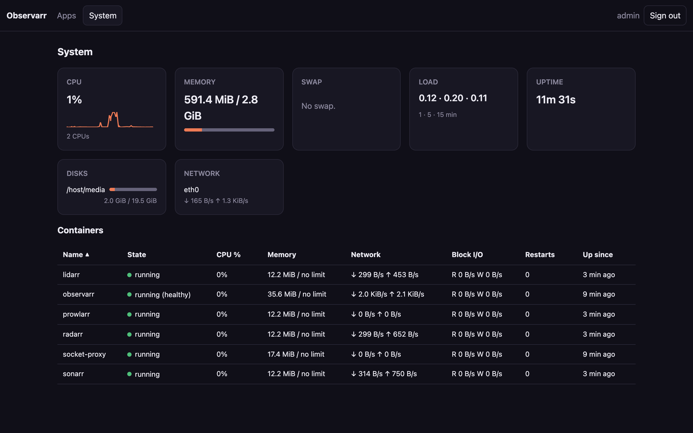
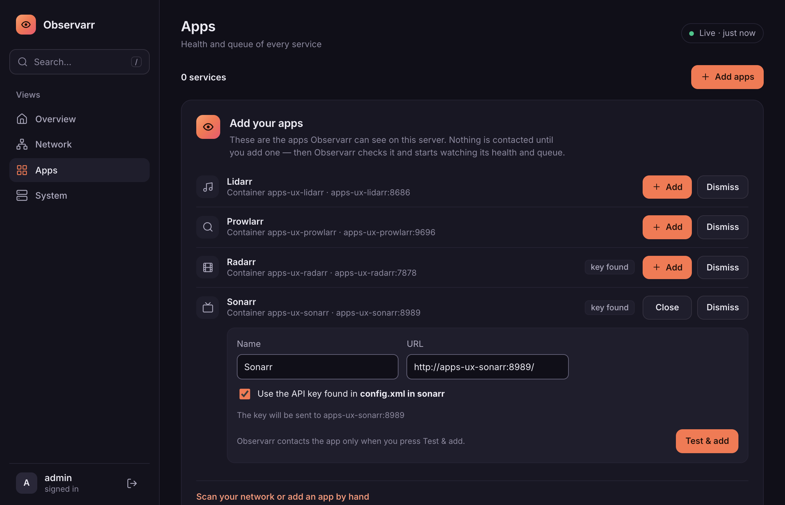
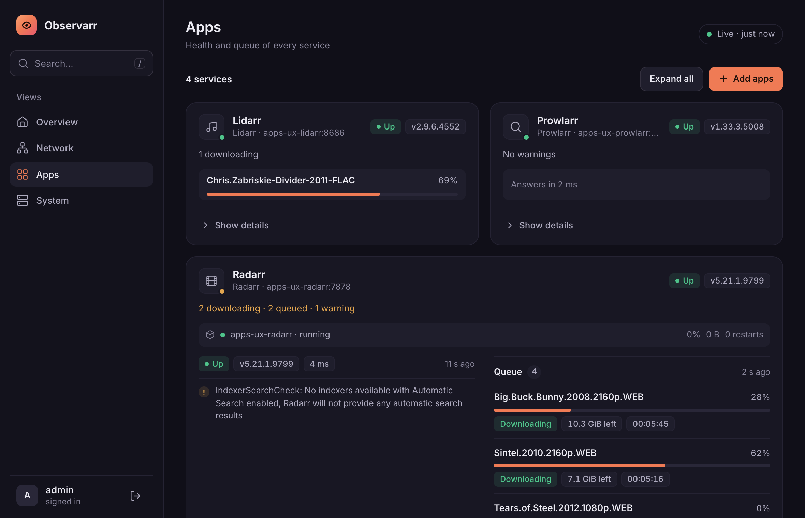
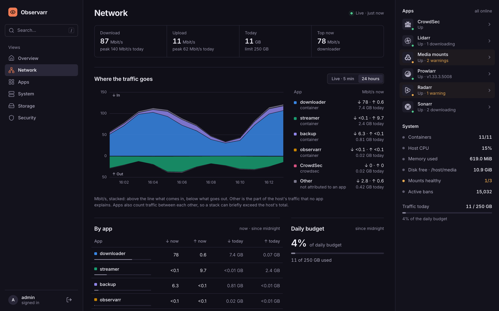
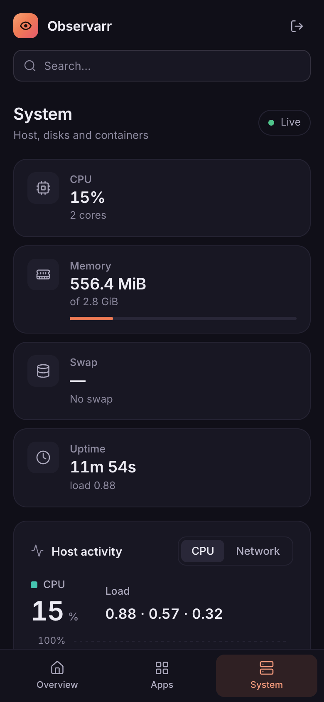

<div align="center">

# Observarr

**A self-hosted ops cockpit for your \*arr and media stack.**

[](https://github.com/whenphdtho/observarr/actions/workflows/ci.yml)



<sub>▶ [Watch in full quality (MP4)](docs/images/demo.mp4)</sub>

</div>

Observarr finds the \*arr apps you run, shows their health and download queues live, and shows what the host
and its containers are doing — all from one small container. Status: early development.

## Features

- **Finds your apps, asks first.** Lists the apps it sees on the server — Docker containers and mounted config
  folders — the moment you open it, without contacting any of them; on request it also scans your network or
  asks Prowlarr for its linked apps. Nothing is added, and no app is contacted, until you click "Test & add".
- **Overview at a glance:** live download and upload with the apps moving the most traffic, services up,
  active downloads, host CPU and memory, and one list of everything that needs attention — down services,
  health warnings, stuck downloads.
- **Network:** where your traffic goes, by app, live and over 24 h — in and out, today's totals per app, and an
  optional daily or monthly budget.
- **Live health and queues** for Sonarr, Radarr, Lidarr and Prowlarr: version, response time, health
  warnings, and every queued download with progress, ETA and import problems, pushed to the browser as they change.
- **System view:** host CPU, memory, swap, load, uptime, disks and network, plus every container's state,
  health, CPU, memory, network, block I/O and restarts — and each app card shows its own container's line.
- **Read-only by design:** host figures come from read-only mounts, container data from a Docker socket proxy
  that only answers GET requests.
- **One container:** a Go binary with the Svelte UI embedded and SQLite for storage, running non-root on a
  distroless image. Saved API keys are encrypted at rest. Works on a phone, too.

<p align="center">
  
  <br>
  <sub>Overview: throughput, key figures and everything that needs attention</sub>
</p>

<table>
  <tr>
    <td width="50%"></td>
    <td width="50%"></td>
  </tr>
  <tr>
    <td align="center"><sub>Network: where the traffic goes, by app</sub></td>
    <td align="center"><sub>Apps: one collapsible card per service</sub></td>
  </tr>
  <tr>
    <td></td>
    <td></td>
  </tr>
  <tr>
    <td align="center"><sub>System: host, disks, network and containers</sub></td>
    <td align="center"><sub>First start: the apps found on the server, added in one click each</sub></td>
  </tr>
  <tr>
    <td></td>
    <td></td>
  </tr>
  <tr>
    <td align="center"><sub>A card expanded: full health, queue and container</sub></td>
    <td align="center"><sub>Network over 24 hours</sub></td>
  </tr>
</table>

<p align="center">
  
  &nbsp;
  
  &nbsp;
  
</p>

## Quick start

```sh
docker build -t observarr .
mkdir -p data && sudo chown 65532 data
docker run -d --name observarr -p 9898:9898 -v "$PWD/data:/data" -e OBSERVARR_INSECURE_COOKIES=1 observarr
docker logs observarr   # shows: setup token: <token> (also in data/setup-token)
```

Open `http://<host>:9898` and create the admin account, entering the setup token from the log line (or the
`setup-token` file in the data folder) — it proves whoever creates the account has access to the host, not
just to the page. The token and the file are both deleted once setup succeeds.

> [!NOTE]
> Logging in needs HTTPS, and Observarr itself serves plain HTTP only. Either put a reverse proxy in front of
> it over HTTPS and set `OBSERVARR_TRUSTED_PROXIES` to the proxy's address (see [Reverse proxy](#reverse-proxy)),
> or, on a plain-HTTP LAN with no proxy at all, set `OBSERVARR_INSECURE_COOKIES=1` as above, which allows the
> login cookie over plain HTTP. Drop `OBSERVARR_INSECURE_COOKIES` as soon as a proxy serves Observarr over HTTPS.

## Run with Docker Compose

For the System view's host and container figures and listing your app containers on the Add apps page, use
[`deploy/docker-compose.yml`](deploy/docker-compose.yml) (Observarr plus a read-only socket proxy) — see
[`docs/deploy.md`](docs/deploy.md) for what each source enables and the security notes. No image is published
yet, so it builds from the repo; adjust the data disk mount first. Its data folder is `deploy/data`; `chown` it
before the first start:

```sh
mkdir -p deploy/data && sudo chown 65532 deploy/data
docker compose -f deploy/docker-compose.yml build
docker compose -f deploy/docker-compose.yml up -d
```

## Adding your apps

Open **Apps → Add apps** (or just start: with no apps yet, the Apps view lists what it found right away).

- **Found on this server** lists, as soon as the page opens, every running Docker container Observarr
  recognises and every app config folder it can read (see below). Listing them contacts no app. Click **Add** on
  a row: name and URL are filled in; enter the API key, or tick "Use the API key found in …" when the app's
  config folder had one (off by default — the key itself never reaches the browser and only goes to the address
  where the app was found). **Test & add** checks the app now and adds it in one step; an error shows right in
  the row. **Dismiss** hides a find for good.
- **Look elsewhere** (folded away): **Scan my network** probes the hosts or private subnets you list, and
  **Linked apps** asks the apps you added (Prowlarr) which apps they are connected to. Their finds are added
  the same way.
- **Add manually** takes app, name, URL and key; **Test**, then **Add**.

<p align="center">
  
</p>

Each app card shows its health, a one-line summary and its leading download or warning; **Show details**
opens the full queue, all warnings, the linked container and Edit/Remove (**Expand all** opens every card; the
browser remembers which cards are open).

For any of these you'll need:

- **Its API key.** In Sonarr, Radarr, Lidarr and Prowlarr: Settings → General → Security → API Key.
- **A URL Observarr can reach:**
  - If Observarr and the app share a Docker network, use the app's **container name** as the host, e.g.
    `http://sonarr:8989`.
  - Otherwise, use the app's **LAN IP address and published port**, e.g. `http://192.168.1.20:8989`.
  - `127.0.0.1` / `localhost` is Observarr's own container — never the app you're adding.

Compose's own `default` network only connects containers started from the *same* compose file. To reach apps
started by another stack, join their existing network:

```yaml
services:
  observarr:
    # ...
    networks:
      - default
      - media   # the *arr apps' own external network

networks:
  media:
    external: true
```

**Docker containers** (needs `OBSERVARR_DOCKER_HOST`) are listed when their image is a known \*arr image
(LinuxServer.io, hotio, or a bare `sonarr`/`radarr`/… repository) or they carry an `observarr.type` label (e.g.
`observarr.type=sonarr`); the suggested URL is `http://<container name>:<port>`, and an `observarr.url` label
overrides it.

**Config folders** (needs `OBSERVARR_APP_CONFIGS`): Observarr reads an app's own `config.xml` to suggest it —
including its API key, which never leaves the server unless you tick "Use the API key found in …" when adding
it. When exactly one container of that app runs on the config's port, the folder's key is offered on that
container's row (and only sent to that container's address). Mount each app's config
directory read-only under one parent folder, one subfolder per app, and point `OBSERVARR_APP_CONFIGS` at it:

```yaml
services:
  observarr:
    image: observarr   # docker build -t observarr . — see Quick start
    environment:
      - OBSERVARR_APP_CONFIGS=/appconfig
    volumes:
      - ./data:/data
      - /srv/sonarr/config:/appconfig/sonarr:ro
      - /srv/radarr/config:/appconfig/radarr:ro
    ports:
      - "9898:9898"
```

The subfolder name (`sonarr`, `radarr`, …) only matters as a hint for apps whose config file doesn't already
say which app it belongs to; either way, nothing is added until you review the suggestion and click Add.

## Configuration

All settings are environment variables.

| Variable | Default | Meaning |
|---|---|---|
| `OBSERVARR_LISTEN` | `:9898` | Listen address. |
| `OBSERVARR_DATA` | `/data` | Data directory (see [Data folder](#data-folder)). |
| `OBSERVARR_SECRET_KEY_FILE` | `<data>/secret.key` | The key that seals every saved API key, if stored elsewhere — can be a Docker/Compose secret (read-only, e.g. mode 0444; only a file others can *write* is refused). |
| `OBSERVARR_INSECURE_COOKIES` | unset | `1` allows login over plain HTTP (LAN without TLS, no reverse proxy). Never set it behind a proxy. |
| `OBSERVARR_TRUSTED_PROXIES` | empty | Comma-separated IPs/CIDRs of a reverse proxy whose `X-Forwarded-For` / `X-Forwarded-Proto` are trusted; nothing else is read from a proxy. Use the proxy's exact address, not a whole Docker network. |
| `OBSERVARR_PROXY_AUTH` | unset | `1` also trusts the proxy's user header for login (needs `OBSERVARR_TRUSTED_PROXIES`). **The proxy must strip or overwrite that header on every request it forwards**, and every user name it sends becomes a full admin. Login, setup and signed-in requests not from a trusted proxy are then refused; still publish no port for Observarr (or only `127.0.0.1:9898:9898`). |
| `OBSERVARR_PROXY_USER_HEADER` | `Remote-User` | Header carrying that user name (read only with `OBSERVARR_PROXY_AUTH=1`). |
| `OBSERVARR_APP_CONFIGS` | unset | Folder with one read-only subfolder per app's config, for config-folder discovery; unset disables it. Must exist at startup if set. |
| `OBSERVARR_HOST_PROC` | unset | The host's `/proc`, mounted read-only (e.g. `/host/proc`): host CPU, memory, load and network. Must exist if set. |
| `OBSERVARR_HOST_CGROUP` | unset | The host's `/sys/fs/cgroup`, mounted read-only (e.g. `/host/sys/fs/cgroup`): per-container CPU, memory, I/O and network. Needs cgroup v2, `OBSERVARR_HOST_PROC` and `cgroup: host`. Must exist if set. |
| `OBSERVARR_HOST_DISKS` | empty | Comma-separated paths inside the container whose disks are measured (e.g. `/host/media`). Each must exist at startup. |
| `OBSERVARR_DOCKER_HOST` | unset | Docker socket proxy, `tcp://host:port` or `unix:///path`: container state, health and events (Observarr only issues GET requests). |
| `OBSERVARR_TRAFFIC_BUDGET` | unset | A traffic budget, down and up together, e.g. `1400GB/day` or `20TB/month` (decimal GB and TB, as providers count). The Network view and the rail then show how much of it is used. |
| `TZ` | `UTC` | Time zone of the day boundary for daily traffic totals and budgets, e.g. `Europe/Berlin`. |
| `OBSERVARR_RESET_DB` | unset | `1` moves a corrupt database aside and starts empty — use once, then unset; setup then needs a fresh setup token. |
| `OBSERVARR_RESET_KEYS` | unset | `1` drops every saved API key when `secret.key` is missing, so they can be re-entered — use once, then unset. |

`OBSERVARR_INSECURE_COOKIES`, `OBSERVARR_PROXY_AUTH`, `OBSERVARR_RESET_DB` and `OBSERVARR_RESET_KEYS` accept
only `0` or `1` (unset is `0`); anything else is a startup error. The container runs as uid 65532, so a
bind-mounted data directory must be writable by it (`chown 65532 ./data`), and it must support hard links (any
local filesystem and Docker volumes do). Go's `GOMEMLIMIT` is honoured too — see
[`docs/deploy.md`](docs/deploy.md#memory).

### Data folder

Everything Observarr keeps lives under `OBSERVARR_DATA`:

- `observarr.db` (plus `observarr.db-wal` and `observarr.db-shm` while running) — the SQLite database,
  including the audit log (pruned to the newest 90 days or 100,000 entries, whichever is hit first) and daily
  traffic totals (kept 35 days).
- `secret.key` — the key that seals every saved API key.
- `setup-token` — the one-time setup token, present only until setup completes.
- `observarr.lock` — held while Observarr runs, so a second instance pointed at the same folder exits instead
  of sharing (and corrupting) the database.
- `backups/` — the newest 5 pre-upgrade database copies.

## Reverse proxy

Any reverse proxy works; a minimal [Caddy](https://caddyserver.com/) example:

```
observarr.example.com {
    reverse_proxy observarr:9898
}
```

Caddy gets you HTTPS (it obtains and renews the certificate itself) and sends HSTS and other security headers —
that's the proxy's job, not Observarr's.

Behind a proxy, always set `OBSERVARR_TRUSTED_PROXIES` to the proxy's address and leave
`OBSERVARR_INSECURE_COOKIES` unset. Without the first, every request seems to come from the proxy: the login
lockout then counts everyone's failed logins together, so a few wrong passwords from anywhere lock everyone
out, and the audit log shows only the proxy's address. The second would let the login cookie travel over plain
HTTP.

If the proxy forwards a trusted login header (Authelia, Authentik, …), set `OBSERVARR_PROXY_AUTH=1` as well.
Observarr then refuses login, setup and signed-in requests that don't come from the proxy, but bind it only to
the proxy's network anyway: in Compose, publish no port for Observarr, or at most `127.0.0.1:9898:9898` when
the proxy runs on the host.

Live updates use Server-Sent Events, which must reach the browser unbuffered. Caddy's `reverse_proxy` already
disables buffering; with nginx, add `proxy_buffering off;` to the matching `location` block.

## Security

- Creating the admin account needs a one-time setup token from the server log, so only someone with access to
  the host can do it. Login needs HTTPS unless you explicitly allow plain HTTP, and repeated failed logins lock
  out further attempts.
- Saved API keys are encrypted with `secret.key`. A key found in a config folder stays on the server unless you
  choose to use it.
- Nothing Observarr reads from can be used to change your system: every host mount is read-only, the socket
  proxy answers only GET requests, and the container needs no capabilities or privilege escalation.
- Read-only still means *visible*: the host `/proc` mount and the socket proxy expose more than Observarr
  itself reads. Read the [security notes in `docs/deploy.md`](docs/deploy.md#security-notes) before enabling
  them, and never expose the socket proxy.

## Recovery

- **Corrupt database.** Observarr never resets it on its own: startup exits with an error naming the file.
  Restore it from a backup, or start once with `OBSERVARR_RESET_DB=1` to move it aside and start empty (setup
  then needs a fresh setup token).
- **Missing `secret.key`.** If services with saved keys exist, Observarr refuses to start rather than silently
  losing track of them. Restore the key, or start once with `OBSERVARR_RESET_KEYS=1` to drop the saved keys and
  re-enter them — the services themselves are kept.
- **Backups** are written to `<data>/backups` before each database migration (newest 5 kept). Back that folder
  up together with `secret.key` — a database without its key can't decrypt the saved API keys.
- **Monitoring.** `GET /api/health` returns 503 `{"status":"degraded","reason":"…"}` when the database can't be
  written (read-only or full disk). The container's `HEALTHCHECK` already calls it (`observarr -health`); point
  external monitoring at the same endpoint.

## Docs

- [`docs/deploy.md`](docs/deploy.md) — host and container figures: compose example, cgroup v1, System view
  notes, memory and security notes.
- [`docs/adapters.md`](docs/adapters.md) — how adapters work and how to add an app.

## Development

`make ui` builds the web app, `make check` runs gofmt, vet and tests, `make build` builds the binary.

## License

[GPL-3.0](LICENSE). The UI ships the [Inter](https://github.com/rsms/inter) font (SIL Open Font License,
[web/src/assets/fonts/LICENSE-Inter.txt](web/src/assets/fonts/LICENSE-Inter.txt)) and icons from
[Lucide](https://lucide.dev) (ISC, [web/src/lib/icons/LICENSE-Lucide.txt](web/src/lib/icons/LICENSE-Lucide.txt)).
