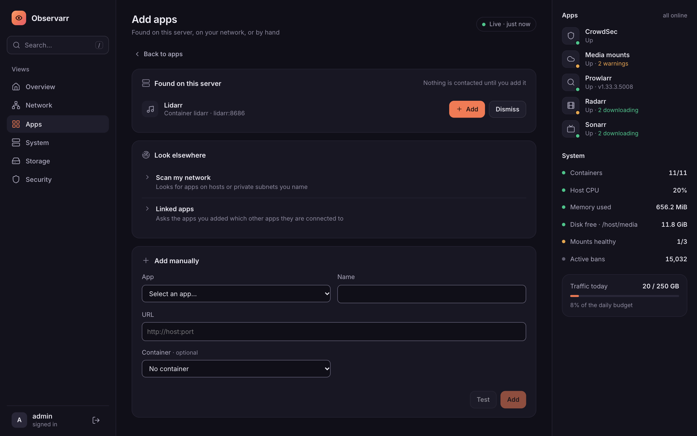

# Configuration and operation

Everything beyond the [Quick start](../README.md#quick-start): adding apps in detail, every setting, the data folder, running behind a reverse proxy, security and recovery. For host and container figures, Storage with rclone and connecting CrowdSec, see [deploy.md](deploy.md).

## Adding your apps

Open **Apps → Add apps** (or just start: with no apps yet, the Apps view lists what it found right away).

- **Found on this server** lists, as soon as the page opens, every running Docker container Observarr
  recognises and every app config folder it can read (see below). Listing them contacts no app. Click **Add** on
  a row: name and URL are filled in; enter the API key, or tick "Use the API key found in …" when the app's
  config folder had one (off by default — the key itself never reaches the browser and only goes to the address
  where the app was found). **Test & add** checks the app now and adds it in one step; an error shows right in
  the row. **Dismiss** hides a find for good.
- **Look elsewhere** (folded away): **Scan my network** probes the hosts or private subnets you list, and
  **Linked apps** asks the apps you added (Prowlarr) which apps they are connected to. Their finds are added
  the same way.
- **Add manually** takes app, name, URL and key; **Test**, then **Add**.

<p align="center">
  
</p>

Each app card shows its health, a one-line summary and its leading download or warning; **Show details**
opens the full queue, all warnings, the linked container and Edit/Remove (**Expand all** opens every card; the
browser remembers which cards are open).

For any of these you'll need:

- **Its API key.** In Sonarr, Radarr, Lidarr and Prowlarr: Settings → General → Security → API Key. In
  Jellyfin: Dashboard → API Keys → add one named Observarr (see [deploy.md](deploy.md#connect-jellyfin)).
- **A URL Observarr can reach:**
  - If Observarr and the app share a Docker network, use the app's **container name** as the host, e.g.
    `http://sonarr:8989`.
  - Otherwise, use the app's **LAN IP address and published port**, e.g. `http://192.168.1.20:8989`.
  - `127.0.0.1` / `localhost` is Observarr's own container — never the app you're adding.

Compose's own `default` network only connects containers started from the *same* compose file. To reach apps
started by another stack, join their existing network:

```yaml
services:
  observarr:
    # ...
    networks:
      - default
      - media   # the *arr apps' own external network

networks:
  media:
    external: true
```

**Docker containers** (needs `OBSERVARR_DOCKER_HOST`) are listed when their image is a known \*arr image
(LinuxServer.io, hotio, or a bare `sonarr`/`radarr`/… repository) or they carry an `observarr.type` label (e.g.
`observarr.type=sonarr`); the suggested URL is `http://<container name>:<port>`, and an `observarr.url` label
overrides it.

**Config folders** (needs `OBSERVARR_APP_CONFIGS`): Observarr reads an app's own `config.xml` to suggest it —
including its API key, which never leaves the server unless you tick "Use the API key found in …" when adding
it. When exactly one container of that app runs on the config's port, the folder's key is offered on that
container's row (and only sent to that container's address). Mount each app's config
directory read-only under one parent folder, one subfolder per app, and point `OBSERVARR_APP_CONFIGS` at it:

```yaml
services:
  observarr:
    image: ghcr.io/whenphdtho/observarr:latest
    environment:
      - OBSERVARR_APP_CONFIGS=/appconfig
    volumes:
      - ./data:/data
      - /srv/sonarr/config:/appconfig/sonarr:ro
      - /srv/radarr/config:/appconfig/radarr:ro
    ports:
      - "9898:9898"
```

The subfolder name (`sonarr`, `radarr`, …) only matters as a hint for apps whose config file doesn't already
say which app it belongs to; either way, nothing is added until you review the suggestion and click Add.

For Overseerr and Jellyseerr the key is under Settings → General → API Key; see
[deploy.md](deploy.md#connect-overseerr-or-jellyseerr).

## Configuration

All settings are environment variables.

| Variable | Default | Meaning |
|---|---|---|
| `OBSERVARR_LISTEN` | `:9898` | Listen address. |
| `OBSERVARR_DATA` | `/data` | Data directory (see [Data folder](#data-folder)). |
| `OBSERVARR_SECRET_KEY_FILE` | `<data>/secret.key` | The key that seals every saved API key, if stored elsewhere — can be a Docker/Compose secret (read-only, e.g. mode 0444; only a file others can *write* is refused). |
| `OBSERVARR_INSECURE_COOKIES` | unset | `1` allows login over plain HTTP (LAN without TLS, no reverse proxy). Never set it behind a proxy. |
| `OBSERVARR_TRUSTED_PROXIES` | empty | Comma-separated IPs/CIDRs of a reverse proxy whose `X-Forwarded-For` / `X-Forwarded-Proto` are trusted; nothing else is read from a proxy. Use the proxy's exact address, not a whole Docker network. |
| `OBSERVARR_PROXY_AUTH` | unset | `1` also trusts the proxy's user header for login (needs `OBSERVARR_TRUSTED_PROXIES`). **The proxy must strip or overwrite that header on every request it forwards**, and every user name it sends becomes a full admin. Login, setup and signed-in requests not from a trusted proxy are then refused; still publish no port for Observarr (or only `127.0.0.1:9898:9898`). |
| `OBSERVARR_PROXY_USER_HEADER` | `Remote-User` | Header carrying that user name (read only with `OBSERVARR_PROXY_AUTH=1`). |
| `OBSERVARR_APP_CONFIGS` | unset | Folder with one read-only subfolder per app's config, for config-folder discovery; unset disables it. Must exist at startup if set. |
| `OBSERVARR_HOST_PROC` | unset | The host's `/proc`, mounted read-only (e.g. `/host/proc`): host CPU, memory, load and network. Must exist if set. |
| `OBSERVARR_HOST_CGROUP` | unset | The host's `/sys/fs/cgroup`, mounted read-only (e.g. `/host/sys/fs/cgroup`): per-container CPU, memory, I/O and network. Needs cgroup v2, `OBSERVARR_HOST_PROC` and `cgroup: host`. Must exist if set. |
| `OBSERVARR_HOST_DISKS` | empty | Comma-separated paths inside the container whose disks are measured (e.g. `/host/media`). Each must exist at startup. |
| `OBSERVARR_DOCKER_HOST` | unset | Docker socket proxy, `tcp://host:port` or `unix:///path`: container state, health and events (Observarr only issues GET requests). |
| `OBSERVARR_TRAFFIC_BUDGET` | unset | A traffic budget, down and up together, e.g. `1400GB/day` or `20TB/month` (decimal GB and TB, as providers count). The Network view and the rail then show how much of it is used. |
| `TZ` | `UTC` | Time zone of the day boundary for daily traffic totals, budgets and the history's hours and days, e.g. `Europe/Berlin`. Hours and days kept before a change of `TZ` begin at the old zone's boundaries and are left out of the week, month and year views. |
| `OBSERVARR_RESET_DB` | unset | `1` moves a corrupt database aside and starts empty — use once, then unset; setup then needs a fresh setup token. |
| `OBSERVARR_RESET_KEYS` | unset | `1` drops every saved API key when `secret.key` is missing, so they can be re-entered — use once, then unset. |

`OBSERVARR_INSECURE_COOKIES`, `OBSERVARR_PROXY_AUTH`, `OBSERVARR_RESET_DB` and `OBSERVARR_RESET_KEYS` accept
only `0` or `1` (unset is `0`); anything else is a startup error. The container runs as uid 65532, so a
bind-mounted data directory must be writable by it (`chown 65532 ./data`), and it must support hard links (any
local filesystem and Docker volumes do). Go's `GOMEMLIMIT` is honoured too — see
[`docs/deploy.md`](deploy.md#memory).

### Data folder

Everything Observarr keeps lives under `OBSERVARR_DATA`:

- `observarr.db` (plus `observarr.db-wal` and `observarr.db-shm` while running) — the SQLite database,
  including:
  - the audit log, pruned to the newest 90 days or 100,000 entries, whichever is hit first;
  - daily traffic totals for the budget, kept 35 days;
  - the history behind the charts: the host's traffic, each app's traffic and the host's CPU and memory, by
    minute (kept 48 hours), by hour (kept 35 days) and by local day (kept 800 days, so a year can be compared
    with the one before). Each bucket holds at most 64 traffic sources — the host, the 62 busiest apps, and the
    rest summed as one — so the history stays a few tens of MB at most.

  Old rows are removed hourly.
- `secret.key` — the key that seals every saved API key.
- `setup-token` — the one-time setup token, present only until setup completes.
- `observarr.lock` — held while Observarr runs, so a second instance pointed at the same folder exits instead
  of sharing (and corrupting) the database.
- `backups/` — the newest 5 pre-upgrade database copies.

## Reverse proxy

Any reverse proxy works; a minimal [Caddy](https://caddyserver.com/) example:

```
observarr.example.com {
    reverse_proxy observarr:9898
}
```

Caddy gets you HTTPS (it obtains and renews the certificate itself) and sends HSTS and other security headers —
that's the proxy's job, not Observarr's.

Behind a proxy, always set `OBSERVARR_TRUSTED_PROXIES` to the proxy's address and leave
`OBSERVARR_INSECURE_COOKIES` unset. Without the first, every request seems to come from the proxy: the login
lockout then counts everyone's failed logins together, so a few wrong passwords from anywhere lock everyone
out, and the audit log shows only the proxy's address. The second would let the login cookie travel over plain
HTTP.

If the proxy forwards a trusted login header (Authelia, Authentik, …), set `OBSERVARR_PROXY_AUTH=1` as well.
Observarr then refuses login, setup and signed-in requests that don't come from the proxy, but bind it only to
the proxy's network anyway: in Compose, publish no port for Observarr, or at most `127.0.0.1:9898:9898` when
the proxy runs on the host.

Live updates use Server-Sent Events, which must reach the browser unbuffered. Caddy's `reverse_proxy` already
disables buffering; with nginx, add `proxy_buffering off;` to the matching `location` block.

## Security

- Creating the admin account needs a one-time setup token from the server log, so only someone with access to
  the host can do it. Login needs HTTPS unless you explicitly allow plain HTTP, and repeated failed logins lock
  out further attempts.
- Saved API keys are encrypted with `secret.key`. A key found in a config folder stays on the server unless you
  choose to use it.
- Nothing Observarr reads from can be used to change your system: every host mount is read-only, the socket
  proxy answers only GET requests, and the container needs no capabilities or privilege escalation.
- Read-only still means *visible*: the host `/proc` mount and the socket proxy expose more than Observarr
  itself reads. Read the [security notes in `docs/deploy.md`](deploy.md#security-notes) before enabling
  them, and never expose the socket proxy.

## Recovery

- **Corrupt database.** Observarr never resets it on its own: startup exits with an error naming the file.
  Restore it from a backup, or start once with `OBSERVARR_RESET_DB=1` to move it aside and start empty (setup
  then needs a fresh setup token).
- **Missing `secret.key`.** If services with saved keys exist, Observarr refuses to start rather than silently
  losing track of them. Restore the key, or start once with `OBSERVARR_RESET_KEYS=1` to drop the saved keys and
  re-enter them — the services themselves are kept.
- **Backups** are written to `<data>/backups` before each database migration (newest 5 kept). Back that folder
  up together with `secret.key` — a database without its key can't decrypt the saved API keys.
- **Monitoring.** `GET /api/health` returns 503 `{"status":"degraded","reason":"…"}` when the database can't be
  written (read-only or full disk). The container's `HEALTHCHECK` already calls it (`observarr -health`); point
  external monitoring at the same endpoint.

## Backup and restore

**System → Backup and restore** moves your setup to another server, or keeps a copy of it, as one file
(`observarr-settings-YYYY-MM-DD.json`).

- **What it holds:** every app (type, name, URL, linked container) with its API key, and the finds you dismissed.
  Never user accounts or passwords, sessions, the audit log, traffic and host history, the setup token or
  `secret.key`.
- **Export** encrypts the keys with a passphrase you type (at least 12 characters), and asks for your own
  password first, so a session alone cannot take the keys out; wrong passwords count as failed logins. Everything
  else stays readable JSON, so you can see what the file holds. Keep the passphrase: without it the keys cannot be
  restored. Or choose **Leave keys out**: the file then holds no secrets, needs no password, and each app shows
  "API key missing" after restoring until you enter its key again. An account that signs in through a login proxy
  has no password here and can export only without keys.
- **Restore** reads the file and its passphrase and shows what it holds before anything is saved. Then choose
  **Add alongside** (apps whose name is already in use here are skipped) or **Replace all** (every app saved here
  is removed first; tick that you agree to remove them, and a file with no app to restore replaces nothing), and
  apply. Either way all of it is saved at once or not at all. Restored apps are contacted
  only by the normal polling afterwards; their keys are re-encrypted with this server's `secret.key`.
- A wrong passphrase, or a file changed after export, restores nothing. Every URL is checked as when adding an
  app by hand; apps of a type this Observarr does not know are skipped and listed. Files over 1 MiB are refused.
- Exports, restores, wrong passwords and wrong passphrases are written to the audit log; after 5 wrong passphrases in 15 minutes
  restoring pauses for that user.

The keys are encrypted with AES-256-GCM under a key derived from the passphrase with argon2id (64 MiB, 3 passes,
4 lanes) and a random salt; the rest of the file is bound to them, so it cannot be edited unnoticed. For a full
copy of the server, including history and accounts, back up the data folder and `secret.key` instead (see
[Recovery](#recovery)).

## Usenet downloaders

SABnzbd and NZBGet keep their settings in one file each rather than a `config.xml`. Mount their config folders
like the others (e.g. `/srv/sabnzbd/config:/appconfig/sabnzbd:ro`) and Observarr reads `sabnzbd.ini` (the API
key, port and URL base) or `nzbget.conf` (`ControlUsername`, `ControlPassword` and `ControlPort`). As with every
found key, it is used only when you tick "Use the API key found in …" when adding the app. Connecting them is in
[deploy.md](deploy.md#connect-sabnzbd-and-nzbget).

## Alerts

**System → Alerts** (or the bell in the header, which counts the errors and warnings firing as alerts now) sends
a message when something needs attention, even while nobody has Observarr open.

- **Channels:** ntfy (server, `https://ntfy.sh` by default, topic and an optional access token), Discord (webhook
  address), a generic webhook (address and an optional signing secret), email over SMTP (STARTTLS or TLS; mail is
  never sent unencrypted and the password only ever goes over TLS; the server is greeted with the From address's
  domain unless another name is set), Gotify (server and app token) and Telegram
  (bot token and chat). A channel is saved off: **Send test**, and once a test gets through, switch it on.
  Changing where it sends switches it off until it passes a test again. Each channel picks the rules it receives.
- **Secrets** (tokens, the ntfy topic, webhook addresses, the SMTP password, the signing secret) are encrypted with
  `secret.key` like API keys, never shown again and never logged; the API only says whether one is saved. Tokens
  and passwords need at least 8 characters, a signing secret 16. Changing a channel's server needs its secrets
  again, and changing a webhook's address its signing secret.
- **Rules**, each on or off: a service down for N minutes (3 by default) or a container dead, restarting or
  unhealthy; health warnings and errors an app reports (including the downloads a downloader says failed in the
  last day); a disk or cache at N % (90 by default) or a mount that is not mounted, out of space or failing to
  upload; the traffic budget at 80 % and 100 %; sign-in lockouts and N failed sign-ins in 15 minutes; downloads
  stuck or failed; and, off by default, requests waiting for approval. Worked out on the server, they are also the
  Overview's "Needs attention" (every rule, before any waiting), which the live stream carries.
- **Mute:** a row of "Needs attention" can be muted for an hour, eight hours or a day
  (`POST /api/alerts/mutes` with `{"key", "minutes": 60 | 480 | 1440}`, `DELETE /api/alerts/mutes?key=…`). A muted
  problem stays listed, dimmed, with when its mute ends, but sends nothing and is not counted in the title, the
  tab or the bell. The mute ends on its own at its time (a problem still there is reported once more), when the
  problem has been over for a minute (no "resolved" is sent; one that comes back sooner stays muted) or when it
  gets worse. Mutes survive a restart, at most 500 are kept, and they
  are in no settings file.
- **When:** the rules are checked on every change and every 30 s. A problem is sent once it has lasted its time
  (a minute for health warnings, five for storage and downloads), and again when it is over (after a minute
  without it). Optionally, alerts still firing are sent again after a few hours. Each channel takes at most
  30 messages an hour (configurable); beyond, one message says how many were held back. In optional quiet hours
  only critical alerts go out; the rest, and that an alert is over, follow in one summary. A failed delivery is tried three times, with
  growing waits. Firing alerts are kept in the database, so a restart sends nothing again.
- **Log:** the latest alerts and what each channel made of them (sent, failed with a short reason, held,
  suppressed); the newest 1000 are kept.

Every message leaves through a client that refuses link-local and cloud metadata addresses (169.254.0.0/16,
`fd00:ec2::254`, …) and follows no redirects; addresses on your LAN are fine. Set **Observarr's address** in the
rules to get links back to it.

A webhook gets a JSON POST:

```json
{"event": "firing", "severity": "critical", "service": "Sonarr", "title": "Sonarr is not reachable",
 "message": "cannot reach 192.0.2.10:8989: connection refused", "time": "2026-11-26T20:45:19Z",
 "url": "https://observarr.example/#/apps"}
```

`event` is `firing`, `repeat`, `resolved`, `summary` or `test`; `severity` is `critical`, `warning` or `info`;
`service` and `url` may be empty. With a signing secret, `X-Observarr-Signature: sha256=<hex>` carries the
HMAC-SHA256 of the raw body under that secret. Settings export and import include the channels and rules, with
their secrets in the encrypted part of the file (left out, to be entered again, when exported without keys). An
imported channel is always switched off until a test from the new server gets through.
